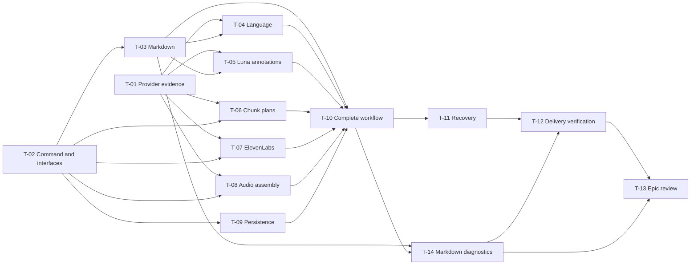

# Markdown to audiobook — ticket plan

## Status and scope

- Epic: `markdown-to-audiobook`.
- Status: implementation and code review complete; manual audio listening is
  pending (2026-11-13).
- Approval: the owner said, "Approved. I'll start implementation separately."
  Approval includes the dependency plan, public test seams, and verification
  requirements used by this implementation session.
- Source: [approved user stories](user-stories.md), approved on 2026-11-13.
- Approval recorded in commit: `d26235a0ec63cacf22838f2f1c9be763286c6e45`.
- Implementation review baseline: `d26235a0ec63cacf22838f2f1c9be763286c6e45`.
- Integration branch: `codex/markdown-to-audiobook`, started at
  `5ff92f81cfa1b64081c90b042888ce38de5fa77f`. The review baseline above remains
  fixed so the final review covers the whole implementation.
- T-01 through T-14 implementation and review outcomes are recorded in the
  integration ledger below. Successful ticket worktrees and branches are
  removed after merge.
- User-directed scope extension (2026-11-13): add T-14 to show the offending
  source line and caret in diagnostics and accept thematic breaks as silent
  Markdown separators. The owner requested both fixes after observing a dry-run
  against their chapter collection. T-14 must merge before T-12 documentation
  verification and T-13 review.

## Dependency map

Prerequisites mean that the ticket has merged into the integration branch and
its merged result has passed verification. Shared-file conflicts below are a
separate scheduling constraint.

| Ticket | Outcome | Stories | Prerequisites |
| --- | --- | --- | --- |
| T-01 | Verify provider capabilities and limits | US-01, US-04–US-07 | none |
| T-02 | Establish command, shared interfaces, and dependencies | US-01 | none |
| T-03 | Validate Markdown and derive narration | US-02 | T-02 |
| T-04 | Select a directory-wide language | US-04 | T-01, T-03 |
| T-05 | Obtain and apply exact-preserving Luna insertions | US-03 | T-01, T-03 |
| T-06 | Plan semantic chunks and estimate narration cost | US-05 | T-01, T-02 |
| T-07 | Resolve eligible voices and synthesize lossless chunks | US-01, US-06 | T-01, T-02 |
| T-08 | Preserve WAVs and assemble chapter MP3s | US-07 | T-01, T-02 |
| T-09 | Persist compatible work and completion records | US-08 | T-02 |
| T-10 | Deliver the complete command workflow | US-01–US-08 | T-03, T-04, T-05, T-06, T-07, T-08, T-09 |
| T-11 | Make interrupted and repeated runs safe | US-08 | T-10 |
| T-12 | Verify the delivered tool and finish user documentation | US-01–US-08 | T-11, T-14 |
| T-13 | Review and resolve the whole epic | US-01–US-08 | T-12, T-14 |
| T-14 | Improve Markdown diagnostics and handle thematic breaks | US-02 | T-03, T-10 |



## Approved interfaces and test seams

Independent tickets need agreed interfaces before separate worktrees implement
them. T-02 records the final Python types and error contracts in
`src/audiobook/contracts.py` and `interfaces.md` in this epic. The operations
below describe the intended public surface; exact argument spelling is an
implementation choice within those contracts.

| Owner | Public interface | Required result or effect |
| --- | --- | --- |
| T-02 | CLI `main`, configuration and chapter discovery | Parsed settings; ordered source paths; actionable command errors |
| T-03 | `prepare_chapter(source)` | Original text, narration projection, allowed insertion locations, and source-positioned diagnostics |
| T-04 | `choose_language(chapters, override, supported_languages)` | One supported language or an actionable error |
| T-05 | `annotate_chapter(prepared_chapter, provider)` | Validated insertion record, annotated Markdown, and annotated narration projection |
| T-06 | `plan_chapter(narration, model_capabilities)` | Ordered chunks, submitted character counts, rate, and estimated cost |
| T-07 | ElevenLabs `resolve_voice` and `synthesize_chunk` | Eligible voice ID; complete PCM audio with explicit format metadata |
| T-08 | `assemble_chapter(audio, destination, speed)` | Retained WAVs and atomically published MP3, or a recoverable error |
| T-09 | Work store: load/save annotation, load/save chunk, load/save completion | Validated, compatible artifacts; explicit absent/stale/incomplete states |
| T-10 | Application run invoked by CLI | The approved end-to-end workflow and mode semantics |

Approval of this plan confirms these additional public module seams for the TDD
skill. Tests may call them directly to establish independent ticket outcomes;
they must not test private helpers or mock internal collaborators. The approved
CLI, external provider protocols, and real ffmpeg seams remain the final
integration evidence.

Shared contracts carry source identity and original positions, insertion
records, speech text, model capabilities, chunks, raw audio format metadata,
settings, artifact compatibility, and domain errors. Source positions are
explicitly defined Unicode character offsets, with one-based diagnostic line
and character numbers. Insertion anchors refer to the unchanged original,
never an already-edited document. Provider requests use explicit model IDs;
there is no implicit fallback to another model or voice.

## Parallel worktrees and shared-file conflicts

Each implementation ticket gets `codex/markdown-to-audiobook-t-NN` and a separate
worktree based on the latest green integration branch at dispatch time. Use the
Codex worktree tool and its required lifecycle operations. Integration, dispatch,
and updates to this ticket ledger have one coordinator.

Suggested initial schedule, subject to available agent slots:

1. Run T-01 and T-02 concurrently. T-01 writes evidence only; T-02 owns source,
   package configuration, and shared interfaces.
2. After T-02 merges, T-03 and T-09 are ready. After T-01 also merges, T-06,
   T-07, and T-08 are ready. Queue ready tickets as slots become available.
3. After T-03 merges and T-01 is green, T-04 and T-05 are ready. They can run
   alongside remaining independent modules.
4. Run T-10 and T-11 in prerequisite order. T-14 can proceed alongside T-12
   in its isolated Markdown/application files; T-12 must merge it before final
   documentation verification. Run T-13 last.

| Shared area | Ownership and conflict rule |
| --- | --- |
| `pyproject.toml`, `uv.lock`, entry point, shared contracts | T-02 owns setup. Later dependency/contract changes go through the coordinator and merge before affected workers resume. |
| Markdown interpretation and source projection | T-03 owns `markdown.py`; T-04 and T-05 consume its interface and do not edit it concurrently. |
| Provider modules | T-05 owns `annotation.py` and its fixed prompt; T-07 owns `elevenlabs.py`. They share contracts, not helper implementations. |
| Other modules | T-04 owns `language.py`; T-06 `planning.py`; T-08 `audio.py`; T-09 `store.py`. Tests are ticket-specific. |
| CLI and orchestration | T-02 establishes `cli.py`; T-10 owns `application.py` and final CLI wiring. T-11 follows T-10. |
| Test infrastructure | T-02 establishes minimal common fixtures; subsequent tickets keep fixtures local. Coordinate any shared `conftest.py` edits. |
| README and final examples | T-12 owns the complete rewrite. Earlier tickets may contribute help text and focused interface documentation. |
| Ticket ledger and review documents | Coordinator owns this file; T-01 owns `provider-capabilities.md`; T-13 owns `code-review.md`. |

T-14 extends the completed Markdown subset after T-03/T-10: it may update
`markdown.py`, diagnostic output in `application.py`, and focused tests. T-12
owns documentation only and must merge T-14 before final verification.

Do not let two workers edit a shared file concurrently simply because their
functional prerequisites are satisfied. Either serialize that edit or extract
and integrate the shared change first. Rebase or merge the current integration
branch before final verification of a ticket. Merge one green ticket at a time,
verify the merged result, and only then release its dependents. Preserve
unmerged work; clean up successful ticket worktrees and branches using the
applicable worktree lifecycle. Contract or acceptance-criteria changes that
alter this plan require whole-plan reconsideration and approval.

## Shared completion requirements

Every code ticket uses one observable behavior per red-to-green slice at its
approved public seam. Keep tests independent of internal module structure and
use literal expected outcomes or independently worked examples. Substitute
external HTTP/WebSocket providers, not application modules; use temporary
directories and dummy keys. Normal automated tests make no paid requests.

Before merging a code ticket, run:

```sh
uv run ruff format --check src tests
uv run ruff check src tests
uv run pytest
uv run ty check src tests
```

Each code ticket is done only when its criteria have evidence, these checks
pass, its focused commit has merged, and relevant checks pass on the merged
result. Record the commit and verification in the ledger. The earlier command
`uv run ty src tests` is not valid for the installed tool; use `ty check`.

Research/documentation tickets use source and artifact inspection instead of
new tests. Configuration changes use dependency resolution and entry-point
inspection in addition to the code checks where applicable. No ticket may
report a partially implemented CLI run as successful narration; before T-10,
unfinished run paths produce a clear nonzero diagnostic.

## Tickets

### T-01 — Establish the provider capability contract

- **Stories:** US-01, US-04, US-05, US-06, US-07.
- **Prerequisites:** none.
- **Type:** research and a bounded provider capability experiment.
- **Owns:** `provider-capabilities.md` in this epic; no application code or
  shared dependency edits.

**Acceptance criteria**

- Record official request/response examples for GPT-6 Luna medium, ElevenLabs
  Turbo WebSocket, standard-v4 REST, voice lookup, supported language codes,
  character limits, and available native lossless output.
- Verify that `gpt-6-luna` is the exact usable model ID and establish its
  structured-output request contract without substituting another model.
- Reuse the existing Dahlia account evidence; document ID
  `JaagUurP1dmW3WscoJ79` and eligibility filtering.
- Establish raw PCM sample rate, sample width, channels, stream completion,
  errors, and any supported continuity mechanism for each speech transport.
  A schema exposing an option alone is not proof that it works.
- Run at most one short synthesis probe per speech model, at most 1,000
  submitted characters per model: published narration value at most $0.12
  total. Use non-sensitive fixture text, retain results and usage, and do not
  automatically retry uncertain paid requests. No paid probes occur while
  drafting this plan.
- If the chosen default cannot deliver native lossless output or another
  required capability, report the evidence and revise affected scope through
  plan approval; do not silently change models or return MP3 converted to WAV.

**Definition of done / evidence**

The report distinguishes documentation, account observations, and probe results;
links primary sources; contains no secrets; and gives downstream tickets a
verified capability table. Inspect report and retained audio metadata, commit
the report, integrate it, and check that its contracts satisfy approved stories.
No automated tests are required for this research ticket.

### T-02 — Establish the CLI and shared interfaces

- **Stories:** US-01; shared interfaces supporting US-02–US-08.
- **Prerequisites:** none.
- **Owns:** `contracts.py`, `cli.py`, package entry point, dependency setup,
  minimal test infrastructure, and epic `interfaces.md`.

**Acceptance criteria**

- Freeze the small public interfaces described above, including compatibility
  identities and error semantics, before independent workers consume them.
- Add the `uv run audiobook` entry point, all approved options/defaults, and
  non-recursive numeric discovery with deterministic ties and unchanged names.
- Integrate dotenv lookup and process-environment precedence without leaking
  keys. Missing required inputs/settings produce clear nonzero diagnostics.
- Declare and lock dependencies needed by ready tickets, including local
  language detection and WebSocket support, compatible with project Python.
- Provide a clean test seam for controlled provider transports; test-only
  wiring does not add provider-debugging controls to the product CLI.

**TDD seam and evidence**

CLI tests establish help/defaults, option overrides, duplicate numeric prefixes,
numeric versus lexical sorting, ignored nested files, no matches, missing input,
and isolated dotenv fallback/precedence. Public contract errors expose useful
messages. Verify `uv sync` and entry-point execution; apply shared merge gates.

### T-03 — Validate Markdown and expose an exact narration projection

- **Stories:** US-02.
- **Prerequisites:** T-02.
- **Owns:** `markdown.py` and focused fixtures/tests.

**Acceptance criteria**

- Return original text, source-positioned diagnostics, narration projection,
  and permitted insertion positions through `prepare_chapter`.
- Handle front matter, headings, prose/emphasis, link labels, images, and image
  descriptions as approved. Bracket checks operate on retained speech, not
  excluded Markdown syntax. Unknown structures and code blocks are diagnosed.
- Define an associated image description as an italic-only caption following
  the image on the same line or the immediately following nonblank line;
  retain ordinary emphasized prose outside that caption position.
- Forced processing returns the same diagnostics and preserves questionable
  prose. Unterminated constructs are not grounds to discard the chapter tail.
- Define heading injection separately from Luna insertions so a generated
  `[chapter]` tag is not rejected as an original-source violation.

**TDD seam and evidence**

Public preparation tests use literal expected speech and exact diagnostic
coordinates, including Unicode, original brackets, a link/image, caption versus
ordinary emphasis, unclosed front matter, and forced unsupported content.
Original input remains unchanged. Apply shared merge gates.

### T-04 — Detect one supported language for the collection

- **Stories:** US-04.
- **Prerequisites:** T-01, T-03.
- **Owns:** `language.py` and focused fixtures/tests.

**Acceptance criteria**

- Use local `py3langid`, following the inspected proof of concept without
  requiring that separate project at runtime.
- Choose one code from original narration prose, honoring an explicit override
  and the verified model-language set.
- Use a deterministic bounded sample: up to 2,000 prose characters per chapter
  and 20,000 characters total, traversed in chapter order. Exclude injected
  directions and front matter. Report the chosen code without invented
  probability/confidence claims.
- Empty/nonlinguistic or unsupported results produce actionable errors with
  `--language` advice. Sample mode uses the same directory-wide selection.

**TDD seam and evidence**

Public language-selection tests establish known English/German/French fixtures,
override precedence, consistent directory selection, and unsupported/empty
results. Demonstrate that added English tags do not influence the input used
for detection. Apply shared merge gates.

### T-05 — Produce exact-preserving annotated chapters with Luna

- **Stories:** US-03.
- **Prerequisites:** T-01, T-03.
- **Owns:** `annotation.py`, the versioned fixed prompt, and focused tests.

**Acceptance criteria**

- Send the chapter directly through httpx to the verified OpenAI endpoint using
  `gpt-6-luna` with medium effort and structured insertion output.
- Validate original-coordinate anchors, insertion order, legal locations, and
  a conservative vocal-direction vocabulary. Preserve every source character,
  including existing brackets under forced source processing.
- Produce both annotated Markdown and its narration projection using the same
  validated insertion record. Do not insert into omitted front matter, image
  captions, formatting destinations, or other excluded structures.
- The fixed prompt requests sparse direction and excludes editorial changes
  and environmental effects. Retain prompt identity and insertion provenance
  for later cache validation. `--force` cannot accept invalid model edits.

**TDD seam and evidence**

Exercise the public annotation interface with a controlled HTTP provider and
literal expected artifacts. Cover repeated text, Unicode anchors, whitespace,
valid vocal tags, malformed output, disallowed effects, invalid locations,
and attempted replacements. Verify the actual outgoing model/effort and direct
text request. Apply shared merge gates.

### T-06 — Produce semantic chunk plans and model-specific estimates

- **Stories:** US-05.
- **Prerequisites:** T-01, T-02.
- **Owns:** `planning.py` and focused tests.

**Acceptance criteria**

- Plan chunks in memory using the verified model limit. Prefer paragraphs,
  then sentences; retain the speech's order and exact coverage and keep a tag
  with its following passage.
- Report unsplittable oversized passages without truncation. Account for all
  submitted tag and text characters using a documented counting convention.
- Return ordered chunks and per-chunk/chapter estimates using Decimal-style
  currency arithmetic and the approved model rates. Keep narration value,
  subscription allowances, and Luna charges distinct.

**TDD seam and evidence**

Public planner fixtures establish paragraph/sentence boundaries, exact-limit
content, a tag near a boundary, complete coverage without duplicated speech,
and oversized failures. Literal 1,000-character inputs yield $0.04 for Turbo
and $0.08 for standard v4. Apply shared merge gates.

### T-07 — Resolve eligible voices and receive lossless narration

- **Stories:** US-01, US-06.
- **Prerequisites:** T-01, T-02.
- **Owns:** `elevenlabs.py`, provider fixtures, and focused tests.

**Acceptance criteria**

- Resolve exact names/IDs through paginated account lookup with
  `include_live_moderated=false`; default to Dahlia's verified ID.
- Reject absent, ambiguous, or live-moderated voices, including explicit IDs.
  Preserve this rule under sample/resume/force modes and report useful errors.
- Implement Turbo WebSocket and standard-v4 REST adapters according to T-01.
  Send the selected language/voice/model, request verified lossless output,
  and return complete audio with sufficient format metadata to form WAVs.
- Validate stream termination, provider errors, and malformed audio messages.
  Mark interrupted or uncertain paid operations explicitly; no blind synthesis
  retries or implicit model substitutions.

**TDD seam and evidence**

Controlled HTTP/WebSocket peers exercise real adapters: pagination, default
ID, duplicate names, forbidden voice IDs, language/model transmission, split
audio frames, provider rejection, malformed frames, and premature disconnect.
Incomplete streams never become successful chunk results. Apply shared gates.

### T-08 — Preserve lossless audio and publish chapter MP3s

- **Stories:** US-07.
- **Prerequisites:** T-01, T-02.
- **Owns:** `audio.py` and focused audio fixtures/tests.

**Acceptance criteria**

- Wrap native PCM using its verified rate, width, and channel metadata; retain
  valid WAV chunks without lossy transcoding or modifying original downloads.
- Assemble in chunk order and encode the final chapter MP3 once with ffmpeg.
  Apply pitch-preserving tempo for finite positive supported speed values.
- Validate the command prerequisite and return clear subprocess/format errors.
  Use argument arrays so spaces and punctuation in paths are handled safely.
- Publish through a temporary destination and atomic replacement only after
  successful encoding. Failure preserves previous MP3s and reusable WAVs.

**TDD seam and evidence**

Public audio operations with tiny known PCM/tone fixtures and real ffmpeg
establish correct WAV metadata, ordered content, playable MP3, unchanged pitch
and changed duration at a non-default speed, path handling, and preservation of
an old output on failure. Use documented tolerances for lossy audio measurements.
Apply shared merge gates.

### T-09 — Persist compatible annotations, chunks, and completion state

- **Stories:** US-08.
- **Prerequisites:** T-02.
- **Owns:** `store.py` and focused tests.

**Acceptance criteria**

- Store user-inspectable artifacts under cwd `audiobook_tmp`, namespaced by
  source identity to avoid collisions between equal filenames from different
  directories. Store source/prompt provenance with annotations.
- Expose absent, valid, stale, and incomplete states. Validate loaded annotation
  records against their original source and retain exact-preservation evidence.
- Match chunk audio by submitted text, model, voice, language, and generation
  settings; record speed in final-output identity rather than raw audio identity.
- Publish cache/completion records atomically. Partial files or corrupt records
  are never returned as complete audio or compatible finished chapters.
- Support refresh writes for `--no-cache` while preserving old complete final
  output until a replacement is available.

**TDD seam and evidence**

Use the public store interface and temporary directories: save/reload literal
artifacts, distinguish same-name sources, invalidate changed provenance or
generation settings, exclude partial writes, and distinguish new playback speed
from new synthesis settings. Apply shared merge gates.

### T-10 — Wire the complete CLI workflow and execution modes

- **Stories:** US-01–US-08.
- **Prerequisites:** T-03, T-04, T-05, T-06, T-07, T-08, T-09.
- **Owns:** `application.py`, final CLI wiring, and end-to-end fixtures/tests.

**Acceptance criteria**

- Wire all stages in the approved processing order. Validate all discovered
  chapters before paid work; source problems stop the run unless forced.
- Select a directory-wide language. Validate voice eligibility before synthesis.
  Print annotation cache reuse, language, ordered chunk statistics, and costs.
- Normal mode renders all selected chapters. Dry-run retains annotations and
  plans but sends no synthesis. Sample annotates only the first chapter and
  renders its first planned chunk. Dry-run plus sample performs no synthesis.
- Save sample WAV/artifacts and publish `<stem>.sample.mp3`; never mark it as a
  complete chapter or replace `<stem>.mp3` with a sample.
- Skip compatible completed chapters normally. `--no-cache` regenerates
  annotations/audio and safely replaces final outputs. Mismatched annotations
  direct the owner to refresh rather than silently using an older chapter.
- Keep diagnostics free of credentials and preserve every original file.

**TDD seam and evidence**

CLI runs with temporary input/output dirs, real processing modules, controlled
HTTP/WebSocket providers, and real ffmpeg demonstrate default Turbo/Dahlia,
standard-v4 override, two ordered chapters, every mode combination, cache
messages, validation-before-payment, and exact output names. Check filesystem
artifacts, outgoing provider payloads, exit codes, and user-visible output.
Apply shared merge gates.

### T-11 — Establish safe interruption, retries, and resumption

- **Stories:** US-08; integration evidence for US-03, US-06, US-07.
- **Prerequisites:** T-10.
- **Owns:** recovery behavior across application/store/provider modules and
  focused repeated-run integration tests; no concurrent writers in those files.

**Acceptance criteria**

- Stop at a failed chunk and retain completed downloads/annotations. A later
  compatible run resumes unfinished work and does not regenerate earlier audio.
- Recheck voice eligibility before resumed synthesis. Reject stale or malformed
  cached artifacts; `--force` does not bypass model or audio validation.
- Bound safe download retries with timeouts and attempt limits. For uncertain
  paid synthesis, persist uncertainty, report possible charges, and require an
  explicit fresh run such as `--no-cache` rather than blindly resubmitting.
- Failed refreshes preserve previous final MP3s and leave no new completion
  record. Changed text/model/voice/language cannot reuse incompatible audio;
  a speed-only change can reuse raw WAVs and rebuild the MP3.

**TDD seam and evidence**

Fault-injected external peers and repeated CLI invocations demonstrate failure
after one successful chunk, safe resume, changed settings, expired eligibility,
interrupted streams, download failure, corrupt cache, failed assembly, and a
failed `--no-cache` replacement. Establish paid-request behavior from captured
external requests, not internal mock call counts. Apply shared merge gates.

### T-12 — Verify delivery and document the usable tool

- **Stories:** US-01–US-08.
- **Prerequisites:** T-11.
- **Owns:** README, help/examples, `.env.example`, generated-artifact ignore
  rules, and epic `verification.md`.

**Acceptance criteria**

- Document actual invocation/options, the two keys, file matching, markup and
  caption rules, voice eligibility, directory language, cache invalidation,
  resumption, ffmpeg prerequisite, and artifact paths.
- Explain that dry-run can incur Luna usage, sample generates one speech chunk,
  listed narration cost is estimated usage value, and native WAV may be 24 kHz.
- Verify fresh dependency sync and the integrated command with controlled
  provider fixtures. Record checks and map every story to its evidence.
- Reuse T-01 provider audio and any subsequent authorized sample where possible.
  Listen for `[chapter]` behavior, sparse direction, pitch/pace, and chunk joins;
  record the listener and observations. If no listening result is available,
  leave that gate explicitly pending instead of claiming completion.
- Additional live generation is limited to the T-01 probe allowance unless the
  owner authorizes more. A failing probe or listening result that changes scope
  goes through the plan-change process.

**Definition of done / evidence**

Inspect documentation against command help and delivered files. Run all shared
checks and fresh `uv sync`; record actual results and outstanding limitations.
Do not create tests solely for documentation edits; retain meaningful existing
integration evidence. Commit, integrate, and verify the merged result.

### T-13 — Review the whole epic and resolve findings

- **Stories:** US-01–US-08.
- **Prerequisites:** T-12.
- **Owns:** epic `code-review.md`; fixes use isolated worktrees with explicit
  scope and affected-file serialization.

**Acceptance criteria**

- Use the code-review skill from the fixed baseline to the integrated result,
  reviewing repository standards and approved stories/tickets as its two axes.
- Record findings, disposition, fixes, and verification in `code-review.md`.
- Fix actionable in-scope findings through green commits, sequential merges,
  and merged-result verification. A scope change requires plan approval.
- Recheck all story evidence, resolve findings, and run the final shared checks.
  Only then mark the epic complete and clean up remaining successful worktrees.

**Definition of done / evidence**

The final review and resolution record is complete, all required tests/checks
pass on the integration branch, and each story has acceptance evidence. Run
existing tests relevant to each fix; add behavior regressions through approved
seams when a fix warrants them. Do not add tests for review prose.

### T-14 — Improve diagnostics and accept thematic breaks

- **Stories:** US-02; user-directed extension recorded above.
- **Prerequisites:** T-03, T-10.
- **Owns:** the final Markdown rule adjustment in `markdown.py`, source excerpts
  in `application.py` diagnostics, and focused regression tests.

**Acceptance criteria**

- Recognize CommonMark thematic breaks made from three or more `*`, `-`, or `_`
  markers, with permitted whitespace and indentation, as silent separators.
  Preserve original Markdown bytes; omit the separator from narration without a
  source error or stray marker characters, while preserving surrounding speech
  order and paragraph separation.
- For user-facing source diagnostics, show the offending source line and a
  caret at the reported column alongside the existing filename, line, column,
  severity, and message. Keep forced processing diagnostics while retaining
  questionable source prose.
- Do not change paid-provider behavior or the existing source-preservation
  contract.

**TDD seam and evidence**

`prepare_chapter` fixtures cover `* * *`, `---`, and `___`, literal expected
narration, no rule diagnostic, and exact source preservation. A public CLI
fixture with unsupported Markdown captures the filename, source line, and caret
at the offending character. Apply shared merge gates.

## Integration ledger

The original plan is approved; the user-directed T-14 scope extension is
recorded above. The coordinator records branch, worktree, ticket commit, merge
commit, and merged-result verification as work proceeds.

| Ticket | Status | Ticket commit | Merge commit | Verification |
| --- | --- | --- | --- | --- |
| T-01 | merged | `9a70275c17996b49b80cc622e27fc080994efeb4`, `4cda3aeef2bf68f7b5d12f338df13d241f88ae7b` | `30dcdcfb581dcd17dd4099bf18d4a4e280caa999` | Account lookups 200; two complete PCM probes (113 chars each, $0.01356); JSON/secret-marker and WAV metadata inspection passed; research ticket, no tests |
| T-02 | merged | `7281ef7cc14a9b6b057b025d795cf22a89ef6ccb` | `e99a5940352ef512763232358cbd23ab483b8f57` | `uv sync`; format/check, pytest (14), ty, and `audiobook --help` pass on merged result |
| T-03 | merged | `57d511a8465ffaefe831a7c949d7a78ebbb674fe` | `5eba60f0d11ad18ef5de93ae028f27c1470c2ec9` | Merged shared gates pass; pytest: 43 (16 Markdown) |
| T-04 | merged | `32b526ba8e57c42b51295d2f714cb4aebfbb1b78` | `656dac7c98034242670db45669b906700df50d77` | Merged shared gates pass; pytest: 88 |
| T-05 | merged | `7169dd80baeb75369737d0522840e5799e668f2a` | `2a58cd1490dfdc8224e8711c96481653ea9e642a` | Merged shared gates pass; pytest: 79; no live provider call |
| T-06 | merged | `87a6fa24885c812684b7d7bbb39510b6a5456c21` | `23ce5b8d93e449aac8a6587c02989b243b4c534c` | Merged shared gates pass; pytest: 66 |
| T-07 | merged | `edcd3ac65947621d984f523e8d0ef855f9749b14` | `385141d2d995fc5bb848d6099fdffbb2e9929b7e` | Merged shared gates pass; pytest: 59 (15 ElevenLabs, loopback peers) |
| T-08 | merged | `5cb48a8d39fa3d16158b076a23ec50cdf12d071a` | `6ccfcb82a3dd9e96b749f5fb54ab49daa26068b9` | Merged shared gates pass; pytest: 99; real ffmpeg checks pass |
| T-09 | merged | `310a975c302fab27460db528f4c2d0ed3feccc7d` | `1afc8298c31fc0e9c7b7c02e3fd34a5b566e01b8` | Merged shared gates pass; pytest: 27 |
| T-10 | merged | `18cf61d75091bad461368611f88c92c8224277e1` | `7eb665650127b0f8e134953120849c2c033be4e7` | Merged shared gates pass; pytest: 109; no live provider calls |
| T-11 | merged | `c219ba4c8c804bdcd23fbe51694e07996eaebeae` | `90558990174878bfaf2074b8f921bd60c2361a97` | Merged shared gates pass; pytest: 118; paid synthesis remains single-attempt |
| T-12 | merged | `b23698805b2f2af75b3793a45e07c8bac0a06163` | `8f8f7c3e2f6355a97eba7ca454178fac25dbaf21` | Fresh offline `uv sync`; CLI help; merged gates pass; pytest: 120; listening pending |
| T-13 | merged | `1c8efe28b6de3fd580553caa1cfff68c2de79d8a` | `297d9a716e5440f9b483385562a19d13fb070d31` | Two-axis review: 0 hard standards violations; 1 judgement-call smell deferred; 1 spec gap fixed; final gates pass (121 tests); listening pending |
| T-14 | merged | `b303ae4eaebe4de016cbe912aafc8e5a652f5aff` | `70c93f343eef7c8fc10fa3bbf144de3c77cfb2e1` | Merged shared gates pass; pytest: 120; 12 user chapters checked offline (53 breaks, no rule diagnostics/projection); no provider calls |

## Notes

- This plan makes image-caption association, bounded language sampling, sample
  naming, Unicode insertion coordinates, and shared public interfaces concrete.
  Whole-plan approval includes these implementation contracts and test seams.
- T-01 probes are acceptance work for future implementation, not work performed
  during ticket generation. They must establish the selected provider's actual
  capabilities before dependent code is dispatched.
- No new user-story scope is introduced by shared interfaces: they allow
  independent modules to satisfy and test the already-approved outcomes.
